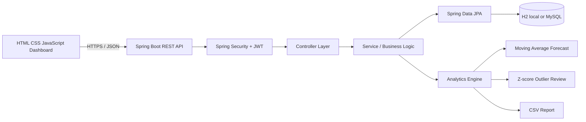

# FinSight architecture

The code is organized into domain entities, repositories, security configuration and a REST controller. The browser never supplies a user ID: the backend derives the account from the verified JWT subject, and all private repository lookups are scoped to that user.

## Data model
- `users`: account identity, BCrypt password hash, role, created timestamp.
- `transactions`: owner, amount (`DECIMAL` / Java `BigDecimal`), type, category, description and date.
- `budgets`: owner, category, month/year and limit; unique per owner/category/month/year.
- `financial_goals`: owner, target and current amount, optional target date.

## Analytics
- Forecast: mean of the previous three calendar months' expense totals.
- Anomaly review: category-specific z-score; only categories with at least four records are considered, and values above +2 are flagged. This is a heuristic, not fraud detection.
- Savings suggestions: initial rule-based guidance displayed in the dashboard.
